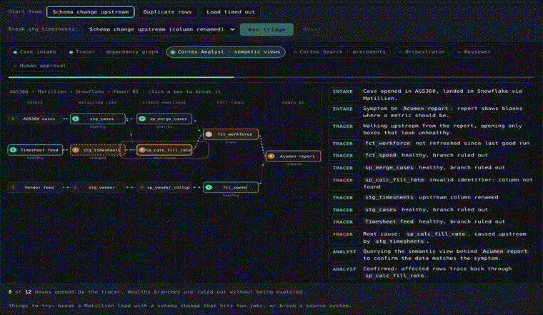

# pipeline-triage-graph

Multi-agent incident triage for data pipelines. When a report looks wrong, a tracer agent walks the
pipeline's dependency graph upstream from the symptom, rules out healthy branches, and stops at the
node that actually broke. Specialist agents then check the data, find similar past cases, classify
the failure and draft a fix. A separate reviewer checks the proposal, and **nothing changes until a
person approves it**.

**How the work is split, and why.** In the original agent at Allegis, the traversal of the dependency graph was
deterministic, a stored procedure, because a wrong root cause is expensive; the LLM was used to orchestrate and to
communicate what the traversal found. This repo keeps that split by default:

* the **tracer** walks the graph with fixed rules and decides the root cause, and the rest of the decision (category,
  plan, review) stays deterministic too;
* the **coordinator** (local Qwen3 8B through Ollama by default) then orchestrates the follow-up: it chooses which
  read-only checks to run for the person deciding, such as what else is affected downstream or a data probe on the
  upstream cause. It runs after the decision and cannot move it, which CI checks on all 200 labelled incidents;
* the **communicator** writes the briefing the person at the approval gate reads, from the findings and those checks
  only, and is checked against them before anyone sees it.

It also measures the alternative Allegis chose not to ship: an **investigator**, an LLM agent that walks the graph itself
through read-only tools. With it on, the tracer cross-checks the model's root cause and any disagreement goes to a
person. On held-out incidents it found the root cause 13 times in 20 against the tracer's 20, which is the measured case
for keeping the traversal deterministic.

This is an open-source rebuild of the pattern behind a triage agent I built during my internship at
Allegis Global Solutions on Snowflake Cortex. None of that code or data is here. This version is
written from scratch, runs anywhere, and ships with its own eval suite.



Try it yourself in the [live demo on my portfolio](https://dhruvdubey3123.github.io/#triage): break any box, run triage, approve or reject the fix.

## The coordinator: the LLM chooses what else to check

```
... -> reviewer (decision made) -> coordinator (LLM, read-only tools) -> communicator (LLM) -> [human gate]
```

The orchestrating half of the Allegis LLM's job. `triage/coordinator.py` gets the decision as fixed context and six
read-only, deterministic tools: `status`, `upstream`, `downstream` (the blast radius of the failure and of the fix), `probe`
(the same data check the analyst uses), `precedents` with its own query, and `finish`. It decides which to call, on what, in
what order, and when to stop. What it finds goes to the communicator and into the run log for the person deciding.

It is placed after the reviewer on purpose. Letting a model choose which evidence feeds a decision would let it move the
decision, so nothing downstream of it reads what it found except the briefing. That is a test rather than a promise:
CI runs every labelled incident, clean and noisy, with a coordinator that calls random tools on random nodes, including
ones that do not exist, and asserts the root cause, category, plan, confidence, review and route are identical to the
rules path. A deliberately broken coordinator that forces the route fails that test.

## The communicator: the LLM explains, the trace stays the facts

```
intake -> tracer -> analyst -> precedent -> classifier -> orchestrator -> reviewer -> communicator (LLM) -> [human gate]
```

`triage/communicator.py` gives the model the findings and nothing else: what the person saw, the path the tracer walked
(including the branches it ruled out), the root cause and its upstream cause, the evidence, the closest resolved cases,
the plan, and what the reviewer flagged. It writes three or four plain sentences for the person deciding. No tools.

A fluent briefing can still mislead, so it is checked before it is shown:

* **it may only name tables and jobs the trace touched or the plan changes**, so it cannot invent a step or point at a job
  nobody examined;
* **it has to name the root cause**, so the one fact the reader needs is never paraphrased away;
* **it may not rename the failure** to a different category from the one the findings settled on;
* **it may not suggest acting on a table or job the plan does not change**, so context the coordinator gathered can inform
  the reader without turning into an extra step.

A briefing that fails is replaced by a template built from the same findings, and the reason is recorded, so the person
always gets one and only a faithful one comes from the model. Escalated incidents get a briefing too, for the owner who
picks them up. The traversal, the plan and the reviewer's decision are identical with or without it, which a test asserts.

```bash
python -m evals.run_eval --coordinator --communicator --skip 60 --limit 20   # the Allegis split: rules decide, the LLM
                                                                            # orchestrates follow-up checks and explains
```

The eval reports how many briefings the model wrote that passed the check, how many fell back, and why.

## An LLM agent that walks the graph itself

```
intake -> investigator (LLM, read-only tools) -> tracer (rules, cross-check) -> ... -> reviewer -> [human gate]
```

`triage/investigator.py` gives the model five tools and nothing that writes:

| Tool | What it returns |
|---|---|
| `pipeline()` | every node, its kind, what it reads from, and which tables are protected |
| `status(node)` | what the incident reports about that node: failed, stale, changed, ok |
| `upstream(node)` | every node it depends on, nearest first, each with its status |
| `precedents(query)` | the most similar resolved cases and how each was fixed |
| `submit_diagnosis(category, fix_target, cause, reason)` | its answer |

The model decides where to look. Around it:

* **Its answer is checked before anything sees it.** An unknown category, a node that is not in the pipeline, or a protected
  table comes back as an error it can read and correct.
* **The first valid answer stands.** A real run of Qwen3 8B submitted the right procedure three times and then talked itself
  into a wrong one, so a valid submission ends the investigation.
* **It never acts.** The plan is derived from its root cause the same way the rule-based orchestrator does it, the reviewer
  checks it, and the approval gate is unchanged.
* **The tracer checks its work.** If the two name different root causes, the reviewer escalates with both traces. The eval
  reports how many wrong diagnoses still reached the approval gate, which is the number that matters.
* **The category stays with the rules.** The model's root cause drives the plan; its category is recorded as a second opinion,
  because a model choosing from a list will put a familiar name on a failure nobody has seen (measured below).

```bash
ollama pull qwen3:8b
pip install -e ".[local]"
python -m evals.run_eval --investigator --skip 60 --limit 20   # TRIAGE_MODEL / TRIAGE_BASE_URL / TRIAGE_API_KEY to override
```

### Measured: two models, held-out incidents

Every row is an incident the model was never adjusted against. Qwen3 8B ran locally through Ollama on an RTX 4060;
GPT-OSS 120B through Groq's free tier, which is the same code and the same prompts with two environment variables changed.

| | Qwen3 8B, incidents 41 to 60 | GPT-OSS 120B, incidents 61 to 80 | Tracer (rules) |
|---|---|---|---|
| Root cause correct | 13 / 20 | **18 / 20** | 20 / 20 on both |
| Category correct (the ones with a single right answer) | 9 / 17 | **18 / 18** | 17 / 17 |
| Submitted a diagnosis | 20 / 20 | 20 / 20 | n/a |
| Disagreed with the tracer on the root cause | 8 / 20 | 2 / 20 | |
| **Wrong diagnoses that reached the approval gate** | **0 of 7** | **0 of 2** | |
| Right diagnoses held back for a person | 0 | 0 | |
| Briefings that passed the faithfulness check | not measured | **20 / 20** | n/a |
| Escalations caught | 3 of 7 | **3 of 3** | 7 of 7 |
| Follow-up checks the coordinator chose | n/a | 5.9 per incident | n/a |

Model size is most of the difference: a 120B model finds nine root causes in ten where an 8B model finds two in three, and
names the category correctly every time where the 8B model managed about half. Neither is trusted on its own. The tracer gets
all 20 either way, so it still decides, and the cross-check is what makes a fallible model usable: across both runs every
wrong diagnosis went to a person and none reached the approval gate.

**The honest cost.** Two of the 120B model's diagnoses were wrong, it disagreed with the tracer on both, and both went to a
person. That is 2 incidents in 20 that a person had to look at and the rules alone would have proposed without help. Catching
every wrong answer and never holding back a right one is worth that.

**The category fix, checked on fresh data.** On incidents 41 to 60 the 8B model named four unrecognised failures as familiar
categories, so they looked routine and only 3 of 7 escalations reached a person. The category now stays with the rules.
SYN-071, in the 61 to 80 run, is exactly that case: an unrecognised failure where the model again submitted a confident
category. It escalated, and the briefing the model wrote says why in its own words: *"The next step is to escalate the
incident to a person. The reviewer flagged an unrecognised failure category, noted that there was no proposal, and
highlighted that the confidence of 0.0 is below the 0.5 threshold."*

**What the coordinator actually chose.** About 6 read-only checks per incident, most often `downstream` (the blast radius of
the failure and of the fix), then `status`, `upstream` and `probe`, with `precedents` occasionally. It reached for impact and
data checks rather than re-deriving the diagnosis, which is the division of work the design intends. Those findings show up
in the briefings: one cites a precedent case the coordinator looked up, by id.

**Speed.** About 50 s per incident on the free tier, which is rate limiting rather than the model: the run sits on an 8K
tokens-per-minute ceiling and waits it out. A paid tier or a local 120B would be seconds.

CI drives the investigator with a scripted model and needs no model at all.

## Running inside the agent harness

Triage stops at the human gate. What happens after approval, actually applying the fix, now runs inside
[agent-harness-runtime](https://github.com/dhruvdubey3123/agent-harness-runtime#running-the-triage-agent-inside-the-harness) through this
project's `Executor` interface. Every warehouse action is logged before and after it runs, so if the process is killed halfway
through a fix, a new process finishes it without re-running a load or posting the ticket comment twice. Across the 75 approvable
incidents in this repo's eval set, crashed at random points: restarting from scratch duplicated an action in 61 of 75 fixes;
resuming through the harness duplicated none and applied every action exactly once in all 75.

## In plain words

A data pipeline is a chain of jobs that move data from one place to another. When one job breaks, a dashboard
several steps downstream goes wrong, and someone has to work out which job actually failed. This project does
that detective work automatically.

* It starts at the broken report and walks upstream, skipping healthy jobs, until it finds the real culprit.
* It searches past incidents for similar cases and drafts a fix.
* It never applies the fix on its own. A person approves or rejects it first.
* When the evidence is ambiguous, it hands the case to a person instead of guessing.

It is my own version of the triage agent I worked on at Allegis, with tests and evals that block a bad change from merging.

```
intake → [investigator] → tracer → analyst → precedent → classifier → orchestrator → reviewer
       → [coordinator] → [communicator]

    passed  → [ human gate ] → approve → apply    → learn
                             → reject  → escalate → learn
    blocked → escalate → learn

    [ ] = only when a model is configured
```

## What each agent does

| Node | Job | Notes |
|---|---|---|
| `intake` | Validate the incident and the symptom node | |
| `investigator` | LLM agent: walk the graph with read-only tools and submit a diagnosis | Only when a model is configured. Its answer drives the plan; the tracer cross-checks it |
| `tracer` | Walk upstream through unhealthy nodes only; rule out healthy branches | Pure graph logic, no LLM. Finds the fix target and any upstream contract change that caused it, or cross-checks the investigator |
| `analyst` | Run data checks on the suspect nodes | `DataProbe` protocol. Default reads recorded observations; plug in a warehouse probe (for example semantic-view queries) |
| `precedent` | Find similar resolved cases | TF-IDF over a YAML case library. Swap for a vector store or Cortex Search |
| `classifier` | Assign a failure category | Rules by default; optional Claude call, validated against allowed categories |
| `orchestrator` | Draft the fix and the re-run plan | Plan is computed from the DAG in topological order |
| `reviewer` | Block unsafe or uncertain proposals | Protected nodes, unknown category, ambiguous trace, low confidence, plan touching the wrong node, investigator and tracer disagreeing |
| `coordinator` | LLM: choose which read-only follow-up checks to run for the person deciding | Only when a model is configured. Runs after the decision and cannot move it (tested on all 200 incidents) |
| `communicator` | LLM: write the briefing for the person deciding, from the findings only | Only when a model is configured. Checked against the trace; falls back to a template |
| `gate` | Human approval | Graph is compiled with `interrupt_before=["gate"]`, so a run always stops here |
| `apply` | Execute the plan | `DryRunExecutor` by default: records what it would do, does nothing |
| `learn` | Append the case to the library | Next similar failure starts from this precedent |

By default the tracer decides the root cause from structure, not from a model, and the eval numbers below are that path.
The coordinator only gathers context and the communicator only explains; the investigator, when on, proposes and
the tracer checks it. Either way nothing is
applied before a person approves.

## Run it

```bash
pip install -e ".[dev]"
pytest -q                                   # 17 tests
python -m evals.run_eval --gate             # eval suite with CI thresholds
uvicorn triage.api:app --reload             # HTTP API on :8000
python -m triage.mcp_server                 # MCP server over stdio
```

Open an incident, then approve or reject it:

```bash
curl -s localhost:8000/incidents -H 'content-type: application/json' -d @examples/incident_schema_drift.json
curl -s localhost:8000/incidents/INC-demo-1/decision -H 'content-type: application/json' -d '{"approve": true, "reviewer": "me"}'
```

What the example run logs before it stops at the gate:

```
      intake  INC-demo-1: Fill-rate tile reads 0% for every client since Tuesday (at rpt_workforce)
      tracer  fct_spend: ruled out, healthy (ok)
      tracer  sp_merge_cases: ruled out, healthy (ok)
      tracer  sp_fill_rate: failed (SQL compilation error: invalid identifier 'REQ_ID')
      tracer  load_timesheets: changed (column REQ_ID renamed to REQUISITION_ID)
      tracer  root cause at sp_fill_rate, caused upstream by load_timesheets
   precedent  CASE-0001 (schema_drift, score 0.417); CASE-0002 (duplicate_merge, score 0.071)
  classifier  schema_drift (schema_drift: 'invalid identifier')
orchestrator  Update sp_fill_rate to match the changed upstream contract (cause: load_timesheets); ...
    reviewer  passed, waiting for human approval
```

### Use it from Claude Code or Claude Desktop (MCP)

```json
{ "mcpServers": { "pipeline-context": { "command": "python", "args": ["-m", "triage.mcp_server"],
  "env": { "TRIAGE_PIPELINE": "/path/to/your/pipeline.yaml" } } } }
```

Tools: `list_nodes`, `get_upstream`, `get_downstream`, `trace_failure`, `search_precedents`. All read-only.

### Optional LLM mode

The communicator ([above](#the-communicator-the-llm-explains-the-trace-stays-the-facts)) replaces the wording half of
this older mode with a checked briefing on a local model. The older mode below still asks Claude for the category and
the wording of the fix:

```bash
pip install -e ".[llm]"
export ANTHROPIC_API_KEY=... TRIAGE_USE_LLM=1   # TRIAGE_MODEL to override the model id
```

## Evaluation

`evals/generate.py` builds labeled incidents from the example DAG by injecting a known fault, marking
everything downstream stale, and adding noise: healthy nodes reported explicitly, a red-herring table
that is late for an unrelated reason, and sometimes a second independent failure (where the right move
is to escalate). `evals/run_eval.py` scores every incident at the gate, before any human decision.

Two sets of 100, both committed under `evals/data/`:

* **clean**: one fault, clear error text
* **noisy**: 35% of incidents also carry a misleading error line from a different failure mode, the way real logs often do

Results from the current commit, offline rules mode, no LLM:

| Metric | Clean | Noisy |
|---|---|---|
| Root cause node correct | 1.00 | 1.00 |
| Upstream cause correct | 1.00 | 1.00 |
| Category correct | 1.00 | 0.81 |
| Right action (propose vs escalate) | 1.00 | 0.95 |
| Escalation recall (should escalate, did) | 1.00 | 0.81 |
| False escalation rate | 0.00 | 0.00 |
| Nodes checked per incident (of 12) | 7.06 | 7.23 |
| p95 latency per incident | 10.8 ms | 12.2 ms |

How to read this honestly:

* **The clean set is a spec test, not an accuracy claim.** I wrote the generator and the rules, so a
  perfect score means the logic does what it was designed to do. It is a regression gate.
* **The noisy set is where it gets interesting.** Structure-based tracing stays correct because it
  never reads error text. Classification does not: a misleading log line fools the rules, and about one
  in five failures that should escalate gets a confident proposal instead. That is exactly why the human
  gate exists, and it is the gap the LLM classifier is meant to close. Measuring LLM mode on the noisy
  set is the next step.
* **These are synthetic incidents on a 12-node example DAG.** They say nothing about failure rates in a
  real warehouse.
* The suite has already earned its keep: an early version of the tracer missed the case where one
  schema change broke two procedures at once. The eval caught it before any test did.

CI (`.github/workflows/ci.yml`) runs the tests and fails the build if either set drops below the floors in
`evals/thresholds*.yaml`.

## Deploy

`Dockerfile` builds a slim non-root image. `k8s/deployment.yaml` has a Deployment with readiness and
liveness probes on `/healthz`, a ConfigMap, a Service, and a HorizontalPodAutoscaler (2 to 6 replicas on CPU).

## Bring your own pipeline

Describe your DAG in YAML (see `examples/pipeline.yaml`), list the nodes the fixer must never write to
under `protected`, and send incidents with a `node_status` map. In a real deployment you would build
the YAML from warehouse lineage and fill `node_status` from your orchestrator's run history.

## Layout

```
triage/dag.py         DAG, tracer, refresh ordering
triage/knowledge.py   classifier rules, case library search, fix templates, confidence heuristic
triage/graph.py       LangGraph state graph with the human gate
triage/service.py     run and resume incidents
triage/api.py         FastAPI
triage/mcp_server.py  MCP server
triage/llm.py         optional Claude calls
evals/                generator, runner, thresholds, committed data
```

## Scope and future work

**In scope, deliberately.** The incidents are synthetic, generated with labels so every claim is measurable, and the pipeline
is a 12-node example. That is the scope of this project, not a gap in it: the point is the design (deterministic decisions,
an LLM that orchestrates and explains inside checks) and numbers anyone can rerun.

**Future scope 1: the LLM drafts the actual fix.** Today the fix text comes from a template per failure category; the model
explains it but does not write it. The next step is a drafting agent that proposes the change itself, the edit to the
procedure's SQL, for a person to review. It needs ground truth first: procedure code and a reference fix for each labelled
incident, so a draft can be scored rather than admired. Until then it would be an unmeasured claim, so it is not built.

**Future scope 2: a real pipeline in production.** Probes and the executor are already interfaces (`triage/adapters.py`):
point `DataProbe` at warehouse queries (for example Snowflake semantic views), `Executor` at the scheduler's API, and run the
service behind the existing FastAPI and MCP endpoints with the Kubernetes manifests in `k8s/`. Applying fixes would go through
[agent-harness-runtime (Keel)](https://github.com/dhruvdubey3123/agent-harness-runtime#scope-and-future-work), which owns that
side.

MIT licensed.
